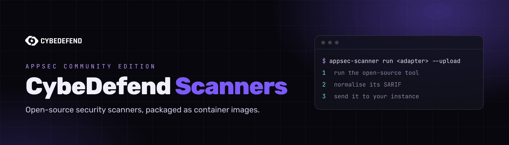
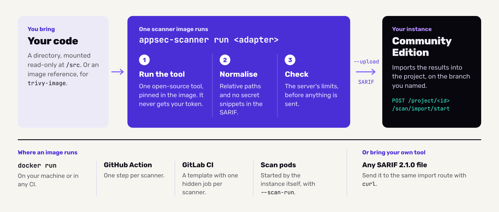
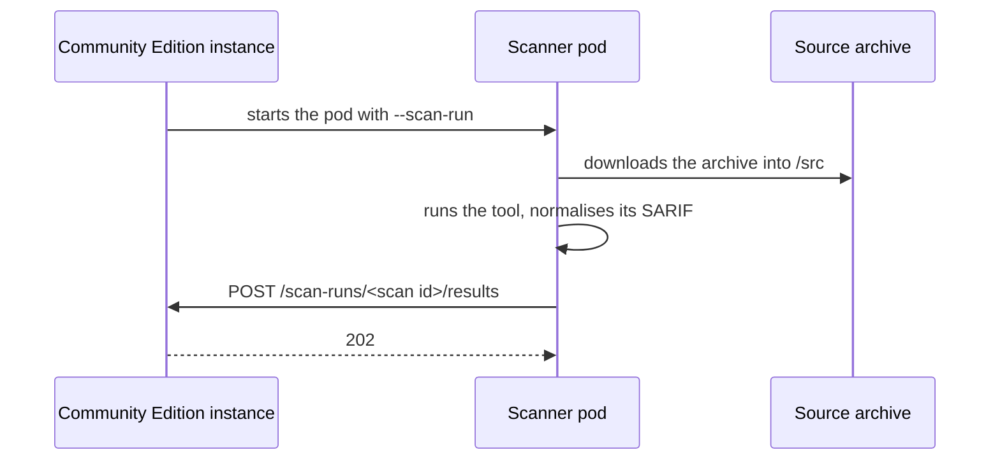

<p align="center">
  
</p>
<h1 align="center">CybeDefend AppSec scanners</h1>
<p align="center">
  <a href="https://github.com/CybeDefend/cybedefend-scanners/actions/workflows/ci.yml"></a>
  <a href="LICENSE"></a>
  
  
  
</p>

Open-source security scanners, packaged as container images, that send their results as SARIF to a self-hosted **CybeDefend AppSec Community Edition** instance. They are for the Community Edition only: CybeDefend Cloud does not take imports, of any type.

| You want to | Read |
|---|---|
| Run a scanner on your code | [Quick start](#quick-start) |
| Send the results of a tool you already run | [Bring your own tool](#bring-your-own-tool) |
| Add a scanner to this repository | [Add a scanner](#add-a-scanner) |
| Know what the scan pods of an instance do | [Scan runs](#scan-runs-cybedefend-community-cluster) |
| Look up a variable, an exit code or a refusal | [Environment](#environment), [Exit codes](#exit-codes), [Refusal messages](#refusal-messages) |

> [!NOTE]
> This repository holds the scanners only. The Community Edition instance they report to is not part of it.

## How it works

<p align="center">
  <picture>
    <source media="(prefers-color-scheme: dark)" srcset=".github/assets/how-it-works-dark.png">
    
  </picture>
</p>

Each image runs one open-source tool on your code (or on a container image), normalises the SARIF it writes (relative paths, no secret snippets, the server's limits checked before anything is sent) and, with `--upload`, sends it to the project's import route. A GitHub Action and a GitLab CI template wrap the images.

## Scanners

| Adapter | Tool | Import type | What it scans, and its image |
|---|---|---|---|
| `opengrep` | [Opengrep](https://github.com/opengrep/opengrep) | `sast` | Source code, with the [12 bundled rules](rules/opengrep/README.md)<br>No registry rule set<br>`ghcr.io/cybedefend/cybedefend-scanners/opengrep` |
| `gitleaks` | [Gitleaks](https://github.com/gitleaks/gitleaks) | `secret` | The files, not the git history<br>Matches are redacted before upload<br>`ghcr.io/cybedefend/cybedefend-scanners/gitleaks` |
| `trivy-config` | [Trivy](https://github.com/aquasecurity/trivy) | `iac` | Terraform, Kubernetes, Dockerfile, CloudFormation, Helm<br>Embedded checks, no download<br>`ghcr.io/cybedefend/cybedefend-scanners/trivy-config` |
| `zizmor` | [zizmor](https://github.com/zizmorcore/zizmor) | `cicd` | GitHub Actions workflows<br>Offline unless `GH_TOKEN` is set<br>`ghcr.io/cybedefend/cybedefend-scanners/zizmor` |
| `trivy-fs` | [Trivy](https://github.com/aquasecurity/trivy) | `sca` | The dependencies of the repository<br>Downloads Trivy's vulnerability database at each run<br>`ghcr.io/cybedefend/cybedefend-scanners/trivy-fs` |
| `trivy-image` | [Trivy](https://github.com/aquasecurity/trivy) | `container` | A container image<br>Downloads Trivy's vulnerability database at each run<br>`ghcr.io/cybedefend/cybedefend-scanners/trivy-image` |

What every image has in common:

- **Platforms.** `linux/amd64` and `linux/arm64`.
- **Tags.** The release version without its leading `v` (`:1.0.0`), its major (`:1`) and `:latest`.
- **User.** They run as uid 65532.
- **Read-only root filesystem.** Supported when `/tmp/appsec-scanner` is writable (an `emptyDir`, or `--read-only --tmpfs /tmp/appsec-scanner:uid=65532,gid=65532`): the tools' `HOME` and `TMPDIR` live there.
- **Tools and licences.** The versions of the tools and their licences are in [`THIRD_PARTY_NOTICES.md`](THIRD_PARTY_NOTICES.md).

## Quick start

You need a project on the Community Edition instance and a personal access token of a user with the `start_scan` permission on it. Keep the token in a secret; never write it in a file of the repository.

### `docker run`

```bash
read -rs CYBEDEFEND_TOKEN && export CYBEDEFEND_TOKEN
export CYBEDEFEND_API_URL=https://appsec.example.com/api
export CYBEDEFEND_PROJECT_ID=<project id>
export CYBEDEFEND_BRANCH=main

docker run --rm -v "$PWD:/src:ro" \
  -e CYBEDEFEND_API_URL -e CYBEDEFEND_TOKEN -e CYBEDEFEND_PROJECT_ID -e CYBEDEFEND_BRANCH \
  ghcr.io/cybedefend/cybedefend-scanners/opengrep:1 --upload
```

The image's entrypoint is `appsec-scanner run <adapter>`: flags such as `--upload` follow the image name. Variables are passed by name (`-e NAME`), so the token never appears on a command line.

A container scan:

```bash
export CYBEDEFEND_IMAGE=registry.example.com/team/api:1.4.0
docker run --rm \
  -e CYBEDEFEND_API_URL -e CYBEDEFEND_TOKEN -e CYBEDEFEND_PROJECT_ID -e CYBEDEFEND_BRANCH \
  -e CYBEDEFEND_IMAGE -e TRIVY_USERNAME -e TRIVY_PASSWORD \
  ghcr.io/cybedefend/cybedefend-scanners/trivy-image:1 --upload
```

[`examples/local/run.sh`](examples/local/run.sh) does the same for any scanner, saves a local image with `docker save` for `trivy-image`, and copies the normalised SARIF to `./cybedefend-<scanner>.sarif`.

### GitHub Action

```yaml
- uses: actions/checkout@3d3c42e5aac5ba805825da76410c181273ba90b1 # v7.0.1
  with:
    persist-credentials: false
- uses: CybeDefend/cybedefend-scanners@<full commit sha> # v1.0.0
  with:
    scanner: opengrep
    version: 1.0.0
    api-url: ${{ vars.CYBEDEFEND_API_URL }}
    project-id: ${{ vars.CYBEDEFEND_PROJECT_ID }}
    token: ${{ secrets.CYBEDEFEND_TOKEN }}
```

Pin the action by commit sha and set `version` to that release. A full workflow with every scanner is in [`examples/github/cybedefend-appsec.yml`](examples/github/cybedefend-appsec.yml).

| Input | Meaning |
|---|---|
| `scanner` | **Required.** One of the six adapters. |
| `api-url` | **Required.** The Community Edition instance's API URL. |
| `project-id` | **Required.** The project the results are imported into. |
| `token` | **Required.** The personal access token. |
| `image` | **Required for `trivy-image`.** The image it scans and uploads.<br>Refused for the other scanners. |
| `branch` | Defaults to the pull request's head branch, else the branch or tag of the run. |
| `path` | Default `.`, the repository root. |
| `version` | The image version; defaults to the tag the action is used at. |
| `upload` | Default `true`. |
| `sarif-output` | The file name of the normalised SARIF. |

The output `sarif-file` is the normalised SARIF, which `github/codeql-action/upload-sarif` can also send to GitHub code scanning.

### GitLab CI

```yaml
include:
  - remote: https://raw.githubusercontent.com/CybeDefend/cybedefend-scanners/v1.0.0/templates/gitlab/cybedefend-scanners.gitlab-ci.yml

sast:
  extends: .cybedefend-sast

container:
  extends: .cybedefend-container
  variables:
    CYBEDEFEND_IMAGE: $CI_REGISTRY_IMAGE:$CI_COMMIT_SHORT_SHA
```

The hidden jobs are `.cybedefend-sast`, `.cybedefend-secret`, `.cybedefend-iac`, `.cybedefend-cicd`, `.cybedefend-sca` and `.cybedefend-container`. Set `CYBEDEFEND_API_URL`, `CYBEDEFEND_PROJECT_ID` and `CYBEDEFEND_TOKEN` (masked) as CI/CD variables in the project's settings. The branch is `$CI_COMMIT_REF_NAME`; `.cybedefend-container` pulls with the job's GitLab registry credentials. `CYBEDEFEND_SCANNERS_VERSION` picks the image version (default `1`).

## SCA and container

> [!IMPORTANT]
> An `sca` or `container` import replaces the branch's whole picture for that type. Read this before you run `trivy-fs` or `trivy-image`.

- **An `sca` import is the branch's whole dependency picture**: the packages it does not report are marked resolved. Run `trivy-fs` on the repository root (the default `/src`), never on a subdirectory, and use one SCA tool per branch.
- **A `container` import is the image's whole picture, per image and branch.** `trivy-image` needs the image reference in `CYBEDEFEND_IMAGE` (or `--image`), as `registry/name[:tag][@sha256:digest]`, 255 characters at most. That reference is what is uploaded, never a name read from the file.
  - It pulls the image itself. A private registry takes `TRIVY_USERNAME` and `TRIVY_PASSWORD` (or `TRIVY_REGISTRY_TOKEN`), which reach Trivy only and are never printed.
  - An image of your local Docker daemon is scanned from a `docker save` archive: mount it and name it with `IMAGE_ARCHIVE` (or `--image-archive`). No Docker socket is used.
- **The vulnerability database.** `trivy-fs` and `trivy-image` download Trivy's database at each run (`mirror.gcr.io/aquasec/trivy-db`, then `ghcr.io/aquasecurity/trivy-db`), so a scan never runs on a database as old as the image. An air-gapped network sets `TRIVY_DB_REPOSITORY` (and `TRIVY_JAVA_DB_REPOSITORY` for Java projects) to a mirror.

## Bring your own tool

Any SARIF 2.1.0 file, from any scanner, can be sent to a Community Edition instance on the same import route, with the same personal access token in `CYBEDEFEND_TOKEN`:

```bash
semgrep scan --sarif --output semgrep.sarif .
curl -H "Authorization: Bearer $CYBEDEFEND_TOKEN" \
  -F file=@semgrep.sarif -F type=sast -F branch=main \
  "$CYBEDEFEND_API_URL/project/$CYBEDEFEND_PROJECT_ID/scan/import/start"
```

`type` is `sast`, `iac`, `secret`, `cicd`, `sca` or `container`; a `container` import also takes `-F image=<reference>`. The answer is `202 { scanId }`.

## Opengrep rules

The `opengrep` image bundles 12 rules of our own, for Python, JavaScript and TypeScript, Java and Go, at `/opt/cybedefend-scanners/rules/opengrep`. They are listed, with their CWE and severity, in [`rules/opengrep/README.md`](rules/opengrep/README.md), and each one is Apache-2.0 (`metadata.license`).

To run another rule set, mount it and name it in `OPENGREP_CONFIG` (files or directories, comma-separated):

```bash
docker run --rm -v "$PWD:/src:ro" -v "$PWD/my-rules:/rules:ro" -e OPENGREP_CONFIG=/rules \
  ghcr.io/cybedefend/cybedefend-scanners/opengrep:1
```

Only local paths are read: a registry name (`auto`, `p/…`, `r/…`, a URL) is ignored, and the image fetches no rule over the network. A third-party rule set comes with its own licence, which may restrict how its rules can be used or redistributed: check it before you mount it, as for any rule your scans depend on. No third-party rule set is bundled in the image.

## Add a scanner

A scanner is one adapter and its image. An adapter runs one tool for one import type (`sast`, `iac`, `secret`, `cicd`, `sca` or `container`). The full guide, with the checks every pull request must pass, is in [`CONTRIBUTING.md`](CONTRIBUTING.md#adding-an-adapter).

| | Where | What |
|---|---|---|
| 1 | `internal/adapter/<name>.go` | **Adapter.** Implement the adapter interface and register it. It builds the tool's command line: SARIF output, no network unless the tool needs its database, findings never turned into a failing exit code. Test the arguments first. |
| 2 | `images/<name>/Dockerfile` | **Dockerfile.** Every `FROM` pinned by digest, every download checked against a `sha256`, uid 65532, the static `appsec-scanner` binary as entrypoint. |
| 3 | `testdata/samples/<name>/` | **Sample.** A small vulnerable sample. Never a real or realistic secret: secret fixtures are generated at test time. |
| 4 | `test/integration/` | **Integration test.** Build tag `integration`: run the built image on the sample against the fake import API and check what was uploaded. |
| 5 | `THIRD_PARTY_NOTICES.md` | **Notices.** The tool, its pinned version and its licence. |

The interface has four methods ([`internal/adapter/adapter.go`](internal/adapter/adapter.go)):

```go
type Adapter interface {
	// Name is the adapter's name on the command line and in the image name.
	Name() string
	// Type is the import type its results are uploaded as.
	Type() ImportType
	// Command returns the tool's argv (never through a shell), and whether
	// the tool writes its SARIF to stdout instead of to out. env is exactly
	// the environment the tool will run with.
	Command(src, out string, env map[string]string) (argv []string, sarifOnStdout bool)
	// SuccessExitCodes are the exit codes that mean « ran », findings or not.
	SuccessExitCodes() []int
}
```

[`internal/adapter/gitleaks.go`](internal/adapter/gitleaks.go) is the shortest one to read first. Optional interfaces in the same file cover the special cases, such as environment variables the tool needs, a container image in place of the source directory, an SBOM or a second run after a failed one.

## Development

```bash
make fmt vet test      # gofmt, go vet, unit tests (no Docker)
make integration       # builds the six images and runs them against a fake import API
```

Go 1.26, standard library only (plus `gopkg.in/yaml.v3` in tests). Committed samples hold no real secret: the secret fixtures are generated at test time.

| Path | What is in it |
|---|---|
| `cmd/appsec-scanner/` | The program every image runs |
| `internal/adapter/` | One adapter per tool, and their registry |
| `internal/runner/`, `internal/sarif/`, `internal/upload/` | Running the tool, reading and normalising its SARIF, sending it |
| `images/<adapter>/Dockerfile` | One image per adapter |
| `rules/opengrep/` | The rules the `opengrep` image bundles |
| `action.yml`, `templates/gitlab/` | The GitHub Action and the GitLab CI template |
| `examples/` | A local script, a GitHub workflow and a GitLab pipeline |
| `test/integration/`, `testdata/` | The integration tests of the built images, and their samples |
| `cmd/fake-api/`, `internal/fakeapi/` | The fake import API the tests upload to |

## Environment

| Variable | Meaning |
|---|---|
| `CYBEDEFEND_API_URL` | The Community Edition instance's API URL, `https://<host>/api` (it serves its API under `/api`). Required with `--upload`. |
| `CYBEDEFEND_PROJECT_ID` | The project the results are imported into. Required with `--upload`. |
| `CYBEDEFEND_TOKEN` (or `CYBEDEFEND_PAT`) | The personal access token, sent as `Authorization: Bearer <token>`. Never printed, never written to the SARIF, never given to the tool. Required with `--upload`. |
| `CYBEDEFEND_BRANCH` | The branch the results belong to. Defaults to `GITHUB_HEAD_REF`, then `GITHUB_REF_NAME`, then `CI_COMMIT_REF_NAME`. Required with `--upload`. |
| `CYBEDEFEND_IMAGE` | The image `trivy-image` scans and uploads (`--image`). Refused by every other scanner. |
| `IMAGE_ARCHIVE` | A `docker save` archive of that image, read instead of pulling it (`--image-archive`, `trivy-image` only). |
| `OPENGREP_CONFIG` | Rule files or directories for `opengrep`, comma-separated, instead of the bundled rules. |
| `GH_TOKEN` | Turns on zizmor's online audits; the only variable zizmor receives. |
| `TRIVY_USERNAME`, `TRIVY_PASSWORD`, `TRIVY_REGISTRY_TOKEN` | Registry credentials of `trivy-image`. |
| `TRIVY_DB_REPOSITORY`, `TRIVY_JAVA_DB_REPOSITORY` | Mirrors of Trivy's databases (`trivy-fs`, `trivy-image`). |
| `TRIVY_INSECURE` | Lets `trivy-fs` and `trivy-image` reach a registry or mirror without TLS verification. |

Flags of `appsec-scanner run <adapter>`:

| Flag | Default | Meaning |
|---|---|---|
| `--source` | `/src` | The directory the tool scans. |
| `--out` | `/tmp/appsec-scanner/results.sarif` | Where the normalised SARIF is written. |
| `--upload` | | Uploads the SARIF to the import route. |
| `--scan-run` | | The mode of a scan pod, [below](#scan-runs-cybedefend-community-cluster). |
| `--timeout` | `30m` | How long the tool may run. |
| `--image`, `--image-archive` | | `trivy-image` only: the image reference, and a `docker save` archive of that image. |
| `--sbom-out` | | `trivy-fs` only, a file: it also writes a CycloneDX JSON SBOM of the source there (every package found, with or without an advisory, its licenses and the dependency graph; paths relative to the source). `--upload` sends the SARIF only. |

There is no commit variable: the results are attached to the branch.

The upload is `multipart/form-data` to `POST <api-url>/project/<project id>/scan/import/start`, gzipped above 1 MiB. The instance answers `202` with the scan id and processes the file afterwards; the scanner does not wait. A failed import names its code in the scan's error message, on the project's scans in the instance.

## Exit codes

| Code | Meaning |
|---|---|
| 0 | The tool ran; the SARIF was written, and uploaded with `--upload` |
| 2 | The tool failed: an exit code outside its success set, no SARIF written, or a timeout |
| 3 | The SARIF was refused locally (limits, invalid JSON) or by the API |
| 4 | Configuration error: a missing project id, token, branch or API URL with `--upload`; an unknown adapter; `trivy-image` without an image, or an invalid image reference; `--scan-run` without its four variables, with `--upload`, or on `trivy-image` |
| 5 | `--scan-run` only: the instance refused the scan protocol (`SCAN_PROTOCOL_UNSUPPORTED`) |
| 6 | `--scan-run` only: the archive of the scan could not be fetched or unpacked |

A tool that exits non-zero only because it found something (Gitleaks, zizmor) counts as a success.

Before sending anything the scanner refuses, as the instance would, a file larger than 50 MB uploaded (gzipped) or 200 MB decompressed, with more than 100,000 results or more than 20 runs.

## Refusal messages

A refusal is read from the response body's `code`, never from its `message`, which is never printed. A known code prints `<CODE>: <sentence>`.

| `code` (HTTP) | Message |
|---|---|
| `IMPORT_INVALID_REQUEST` (400) | `The import request is invalid: check the type and the branch.` |
| `IMPORT_UNSUPPORTED_FORMAT` (400) | `The API accepts only the SARIF format.` |
| `IMPORT_UNSUPPORTED_FILE` (400) | `The upload must be named .sarif, .json or .sarif.gz.` |
| `IMPORT_INVALID_SARIF` (400) | `The file is not valid SARIF 2.1.0 JSON.` |
| `IMPORT_UPLOAD_TOO_LARGE` (413) | `The upload is larger than 50 MB even gzipped. Split the scan into smaller SARIF files.` |
| `IMPORT_BUSY` (503, `Retry-After: 15`) | `The instance is busy; retry in <Retry-After> s.` |
| `IMPORT_STORAGE_UNAVAILABLE` (503) | `The instance's file storage is unavailable. Retry later or ask the administrator.` |
| `IMPORT_UNAVAILABLE` (503) | `The instance could not start processing the import. Retry later or ask the administrator.` |
| `WRITES_BLOCKED` (403, CybeDefend Cloud) | `The organisation cannot start new scans on its current plan.` |
| `IMPORT_IMAGE_REQUIRED` (400) | `A container import needs the image reference (--image).` |
| `IMPORT_IMAGE_INVALID` (400) | `The image reference is not valid: registry/name[:tag][@sha256:digest], 255 characters at most.` |
| `IMPORT_TYPE_NOT_AVAILABLE` (400, CybeDefend Cloud) | `Imports are available only on a Community Edition instance: CybeDefend Cloud does not take them.` |
| no known code, 401 | `The token was refused: it may be expired or revoked. Create a new personal access token.` |
| no known code, 403 | `This token's user lacks the start_scan permission on the project.` |
| no known code, 404 | `Project not found, or not visible to this token's user.` |
| no known code, 413 | `The upload is larger than 50 MB even gzipped. Split the scan into smaller SARIF files.` |
| no known code, 429 | `The API rate limit was reached; retry in <Retry-After> s.` |
| no known code, 503 | `The API is unavailable. Retry later or ask the administrator.` |
| other | `The API refused the import (HTTP <status><, code <code>>).` |

## Community Edition only

`appsec-scanner --upload` sends the instance's `cdp_…` personal access token as a bearer, as it is. CybeDefend Cloud does not take imports, of any type: it answers `IMPORT_TYPE_NOT_AVAILABLE`. The images, the action and the GitLab template upload to a Community Edition instance only.

## Scan runs (CybeDefend Community cluster)

A CybeDefend Community Edition instance connected to a Kubernetes cluster starts one pod per scanner and scan, running `appsec-scanner run <adapter> --scan-run`.



In that mode, `appsec-scanner`:

1. downloads the scan's source archive from `CYBEDEFEND_ARCHIVE_URL` into `--source` (`/src`), within 2 GiB downloaded, 3 GiB unpacked and 200,000 entries; absolute paths and `..` refuse the archive, links are skipped, and the zip is deleted once unpacked. An archive whose only entry is a folder (GitHub and GitLab name it `<repo>-<sha>/`) is scanned from inside that folder, so the results' paths are relative to the repository: they do not carry that folder's name. A ZIP with several top-level entries is scanned as is;
2. runs the tool and normalises its SARIF, as without `--scan-run`;
3. submits the SARIF as `multipart/form-data` (one part `file`) to `POST <api-url>/scan-runs/<scan id>/results`, with `Authorization: Bearer <scan token>` and `X-CybeDefend-Scan-Protocol: 1`.

### The SBOM of `trivy-fs`

`trivy-fs` also sends the source's whole package inventory: one Trivy scan writes its JSON report, which `trivy convert` turns into the SARIF and into a CycloneDX JSON SBOM (every package with its purl, licenses and the dependency graph, paths relative to the repository, the scanned folder named `.`). The SBOM goes as a second part, `sbom` (`results.cdx.json`, `application/vnd.cyclonedx+json`), with `X-CybeDefend-Scan-Protocol: 2`.

When the instance answers `400 SCAN_PROTOCOL_UNSUPPORTED` (it predates protocol 2) or `400 IMPORT_INVALID_SBOM` (it could not read the SBOM; nothing was stored), the same SARIF is sent once more as protocol 1, without the SBOM, and one line says the instance did not accept the SBOM. The SBOM never fails the scan: when it cannot be produced, is not CycloneDX 1.4 to 1.7, or exceeds 50 MB, one line says so and the SARIF goes alone as protocol 1.

### Variables

| Variable | Meaning |
|---|---|
| `CYBEDEFEND_API_URL` | The instance's API URL, `https://<host>/api`. |
| `CYBEDEFEND_SCAN_ID` | The scan, a UUID. |
| `CYBEDEFEND_SCAN_TOKEN` | The token of this pod's upload, spent by one submission. Never printed, never given to the tool. |
| `CYBEDEFEND_ARCHIVE_URL` | The signed URL of the source archive. Never printed, nor its query. |

The instance sets all four; the pod receives the token and the archive URL from a Secret. `--scan-run` cannot be combined with `--upload`, and `trivy-image` refuses it. The download connects within 30 s and ends within 15 minutes.

### Retries

A `409 SCAN_RESULTS_ALREADY_SUBMITTED` counts as done: it answers a retry of a submission whose answer was lost. Network errors and 5xx are retried 3 times (1 s, 5 s, 15 s); a `429` (the route's per-address limit) or a `503 IMPORT_UNAVAILABLE` 6 times, waiting what `Retry-After` asks (60 s at most per wait, 5 minutes in all). `401 SCAN_TOKEN_INVALID`, `413` and `400` are not retried, except the one protocol 1 resend above. All attempts, that resend included, end within 6 minutes.

### Outcome

| Outcome | Exit code |
|---|---|
| Results submitted (`202`), or already submitted (`409`) | 0 |
| The tool failed | 2 |
| The SARIF refused locally, or the submission refused (`SCAN_TOKEN_INVALID`, `IMPORT_*`, after the retries) | 3 |
| A missing or invalid variable | 4 |
| `SCAN_PROTOCOL_UNSUPPORTED`: the image is older or newer than the instance speaks; set `CYBEDEFEND_SCANNER_IMAGE_TAG` to a compatible version | 5 |
| The archive could not be fetched (HTTP status, timeout, limits, unsafe entry) | 6 |

## Licence and contributions

Apache-2.0: see [`LICENSE`](LICENSE) and [`NOTICE`](NOTICE). The bundled tools keep their own licences ([`THIRD_PARTY_NOTICES.md`](THIRD_PARTY_NOTICES.md)).

Contributions are welcome under the Developer Certificate of Origin: sign off every commit (`git commit -s`). See [`CONTRIBUTING.md`](CONTRIBUTING.md), the [code of conduct](CODE_OF_CONDUCT.md) and, to report a vulnerability, [`SECURITY.md`](SECURITY.md).
